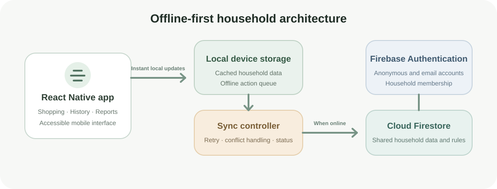

# Our Basket

**An AI-assisted, offline-first Android application for collaborative shopping and household-spending insights.**

Our Basket is designed to solve a practical household problem: keeping a shared shopping list reliable during everyday use, including when internet access is unavailable. It combines collaborative planning, offline actions, purchase tracking, reminders, and spending reports in one mobile experience.

> Portfolio showcase only. The application source code, Firebase configuration, signing credentials, and installable APK are kept private while the product is being prepared for release.

## Project snapshot

| Area | Details |
| --- | --- |
| Product | Shared shopping and household-spending application |
| Platform | Android |
| Development stage | Private real-device testing |
| Primary users | Individuals, couples, and shared households |
| Core approach | Offline-first with automatic cloud synchronization |
| My responsibilities | Product planning, workflow design, UI/UX direction, testing, Firebase setup, debugging, and release preparation |
| Source access | Private during product development |

## Problems addressed

- Shopping lists becoming unavailable or slow when connectivity is unreliable
- Household members losing track of what has already been purchased
- Repeated data entry when recording several purchases from the same shop
- Limited visibility into monthly, yearly, category, and item-level spending
- Reminder notifications continuing after an item is completed or removed
- Mobile forms that are difficult to operate with one hand while shopping

## Key features

- Shared household list with automatic Firebase synchronization
- Offline viewing, adding, editing, and purchase marking
- Automatic synchronization when connectivity returns
- Due dates, categories, preferred shops, search, and filters
- One-handed shopping interactions and compact mobile forms
- Purchase history with editable records
- Monthly and yearly spending reports
- Category and item-level spending insights
- Repeat-purchase suggestions and reminder notifications
- Estimated shop totals based on previous purchase prices
- Optional hand-off to Google Pay or PhonePe
- Email-based account recovery and household backup/restore
- Accessible touch targets, screen-reader labels, and reduced-motion support

## Technology

- TypeScript
- React Native
- Expo SDK 57
- Firebase Authentication
- Cloud Firestore
- AsyncStorage
- Expo Notifications, File System, Document Picker, and Sharing
- Android and Kotlin native project integration

## Architecture overview

The app follows an offline-first approach. Actions update the device immediately and are stored locally. When internet access is available, queued changes synchronize with the shared Firestore household. Firebase Authentication and Firestore security rules limit access to approved household members.

## Role and contributions

- Defined the product requirements and shopping workflows
- Directed the information architecture and UI/UX decisions
- Reviewed and refined forms for one-handed mobile use
- Tested internal Android builds on real devices
- Identified synchronization, notification, restore, and layout issues
- Iteratively improved the product based on household use
- Managed Firebase setup, security rules, recovery, and release preparation

## Skills demonstrated

- Translating household needs into product requirements and usable workflows
- Designing an offline-first mobile experience with synchronization feedback
- Structuring React Native and TypeScript application behaviour
- Working with Firebase Authentication, Firestore data, and access rules
- Iterating on UI hierarchy, mobile forms, accessibility, and one-handed use
- Debugging synchronization, notification, restoration, and layout problems
- Testing Android builds on real devices and preparing a product for release

## AI-assisted development

Our Basket was created using AI-assisted development technology. AI tools supported code generation, debugging, design exploration, documentation, and test iteration. Product decisions, requirements, workflow design, UI/UX direction, real-device testing, and final acceptance were led by **Pramisha K P**.

## Privacy and safety

- Household access is protected through Firebase Authentication and membership-based Firestore security rules.
- Shopping and purchase information is limited to approved household members.
- Offline changes are stored on the device and synchronized when connectivity returns.
- The app does not collect or store payment credentials. Payment actions only open the payment application selected by the user.
- Source code, Firebase configuration, signing credentials, household data, and installable builds are not included in this public portfolio repository.

## Development roadmap

- Complete private household testing and reliability improvements
- Finalize the visual theme, icon system, and product screenshots
- Expand accessibility and usability testing across Android screen sizes
- Complete release preparation, privacy documentation, and Play Store listing
- Publish the first Google Play version

## Release status

Our Basket is currently in private Android testing and is being prepared for a future Google Play release.

Updated product screenshots will be added after the visual theme and icon system are finalized.

**Google Play:** Coming soon

## Source availability

The source repository is private while the product is under development. Selected recruiters or collaborators may be given access separately when appropriate.

## Copyright and usage

Copyright © 2026 Pramisha K P. All rights reserved.

This repository is provided only as a portfolio showcase. Its written content, product concept, branding, architecture diagram, and other materials may not be copied, redistributed, republished, or used to create a competing product without prior written permission. No license to the private application source code is granted or implied.

